# Laporan Proyek — Heterogeneous Multi-Enterprise Agentic AI Ecosystem

**Kelompok 1 · Case Study 10 — International Port, Shipping and Customs Ecosystem**
*Agentic Cargo Intelligence, Port Scheduling, Customs Documentation, Container Tracking and Global Trade Coordination*

Mata kuliah: AI Agentic Technology Systems for Digital Enterprise Ecosystem (Magister)
Tema: *Designing Intelligent, Adaptive, and Collaborative Agentic AI Systems Across Heterogeneous Enterprises*

> Semua nama perusahaan bersifat **fiktif** dan seluruh data **sintetis** (seed tetap, dapat direproduksi).
> Simulator tidak mengendalikan kapal/crane/truk nyata dan **tidak dapat memberikan persetujuan kepabeanan**.

---

## Daftar isi
1. [Business problem & enterprise specification](#1-business-problem--enterprise-specification-15)
2. [Global & local architecture](#2-global--local-architecture-15)
3. [UI/UX tiap perusahaan](#3-uiux-tiap-perusahaan-15)
4. [Model AI & algoritma](#4-model-ai--algoritma-20)
5. [Dataset input–output & schema mapping](#5-dataset-inputoutput--schema-mapping-10)
6. [Adaptive agentic simulation & evaluasi KPI](#6-adaptive-agentic-simulation--evaluasi-kpi-15)
7. [Testing & dokumentasi](#7-testing--dokumentasi-10)
8. [Keterbatasan, etika, dan pengembangan](#8-keterbatasan-etika-dan-pengembangan)
9. [Referensi](#9-referensi)

---

## 1. Business problem & enterprise specification (15%)

### 1.1 Latar belakang
Perdagangan internasional di **Pelabuhan Nusa Raya (fiktif)** melibatkan perusahaan pelayaran, operator terminal,
perusahaan logistik darat, importir, dan otoritas bea cukai. Masing-masing memakai sistem informasi berbeda dan hanya
mau berbagi sebagian data. Proses harus menyinkronkan **jadwal kapal, ketersediaan dermaga, dokumen, pemeriksaan
kepabeanan, dan pengiriman darat**.

### 1.2 Business problem
Kapal kontainer **V001 terlambat ±4 jam** akibat cuaca buruk, padahal dermaga B1 sudah dialokasikan dan kapal lain
(V002) dijadwalkan tiba berikutnya. Sebagian dokumen impor **belum lengkap** (V002/SHP-003), satu deklarasi
**berisiko tinggi** (SHP-006, indikasi *undervaluation*), dan kontainer harus segera dipindahkan ke gudang importir
dengan **armada truk terbatas**. Gangguan tambahan yang diuji: crane rusak, banjir menutup jalan tol, truk ditarik,
dan nota intelijen Bea Cukai.

**Goal:** mengurangi *dwelling time*, biaya keterlambatan, dan konflik penggunaan fasilitas pelabuhan **tanpa
mengabaikan regulasi kepabeanan** (setiap release wajib diputuskan petugas manusia).

### 1.3 Stakeholder, tujuan lokal, dan KPI per perusahaan

| Perusahaan | Pengguna (U_i) | Tujuan lokal | KPI lokal | Utilitas lokal U_i |
|---|---|---|---|---|
| 🚢 **OceanLine Shipping** | Fleet Operator, Commercial Manager | Minim waktu tunggu & telat berangkat | jam tunggu, telat berangkat, biaya tunggu | −(biaya tunggu + penalti telat berangkat) |
| ⚓ **SmartPort Terminal** | Port Planner, Yard Supervisor | Dermaga optimal, minim biaya crane & penalti kontrak | rata tunggu kapal, utilisasi dermaga, versi rencana | THC − biaya crane/gang − penalti kontrak |
| 🚚 **GlobalCargo Logistics** | Logistics Manager, Dispatcher | Truk efisien, SLA terpenuhi | on-time rate, dwelling, truk dipakai | pendapatan trip + surcharge − biaya armada − SLA |
| 📦 **ImportExport Corp** | Trade Officer, Procurement Manager | Barang tiba sebelum batas waktu produksi | dokumen lengkap, jam terlambat, denda | −(biaya trucking + express + denda produksi) |
| 🛃 **Customs Authority** | Customs Officer, Risk Analyst, Supervisor | Kepatuhan tanpa menghambat arus barang | jalur H/K/M, deklarasi menunggu, rilis tanpa persetujuan (=0) | bea masuk − biaya proses − penalti risiko |
| 🌐 **Global Control Center** | Ecosystem Admin, Auditor | Kinerja ekosistem | J, C, T, R, Q | — (koordinator/mediator) |

### 1.4 Model enterprise E_i = (U_i, M_i, D_i, A_i, P_i, G_i)

| E_i | U_i | M_i (modul) | D_i (data lokal) | A_i (agen) | P_i (protokol/API) | G_i (governance) |
|---|---|---|---|---|---|---|
| OceanLine | Fleet Operator, Commercial Mgr, Viewer | vessel tracking, prediksi ETA, manifest, negosiasi | **Document store JSON** di SQLite (`documents(collection, doc_id, body)`) | `eta_agent`, `negotiation_agent`, `manifest_agent` | REST **camelCase**, waktu **UTC "Z"**, knot/nm | manifest hanya ke Customs; utilitas internal tidak dibagi |
| SmartPort | Port Planner, Yard Supervisor | berth scheduling, yard, release kontainer | **SQL relasional ternormalisasi** (`berth`, `vessel_call`, `berth_plan`, `container_batch`, `negotiation`) | `berth_planning_agent`, `yard_agent`, `operations_monitor_agent` | REST **snake_case**, waktu **lokal WIB** | gate-out hanya setelah RELEASED; >3 kapal pindah → Port Planner |
| GlobalCargo | Logistics Mgr, Dispatcher | alokasi truk, rute, kontrak | **SQL PascalCase** (`Truck`, `RoadEdge`, `TransportJob`, `TripPlan`) | `fleet_planning_agent`, `route_agent`, `commercial_agent` | REST **envelope {Status, Data}**, **Unix epoch** | pelanggan hanya lihat pengirimannya; margin tidak dibagi |
| ImportExport | Trade Officer, Procurement Mgr | PO, dokumen, deklarasi, kontrak angkut | **SQL berbahasa Indonesia** (`pesanan_pembelian`, `pengiriman`, `dokumen`, `pemberitahuan_impor`) | `document_agent`, `procurement_agent` | **XML**, tanggal **dd/mm/yyyy** | isi dokumen hanya ke Customs; SmartPort hanya status per kapal |
| Customs | Customs Officer, Risk Analyst, Supervisor | verifikasi dokumen, risk review, keputusan petugas | **SQL + audit hash-chain** (`declarations`, `risk_assessments`, `officer_decisions`, `intel_alerts`) | `risk_agent`, `verification_agent` + **petugas manusia** | JSON **ISO-8601 +07:00**, API key ketat + RBAC `X-User-Role` | skor risiko & intelijen rahasia; **semua release oleh petugas** |

Heterogenitas terjadi pada **≥ 5 dimensi**: model data, database/skema, format API (JSON/XML/envelope),
konvensi penamaan & bahasa, representasi waktu/zona, serta kebijakan keputusan & otorisasi (lihat §2.3).

---

## 2. Global & local architecture (15%)

### 2.1 Arsitektur global

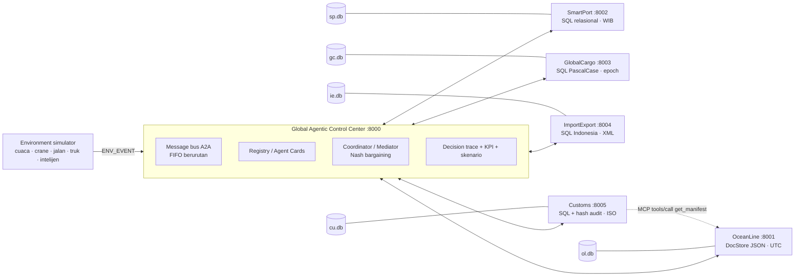

* **6 server FastAPI independen** (port 8000–8005), masing-masing dapat dibuka di browser berbeda (landing page + `/docs`).
* **6 dashboard Streamlit independen** (port 8500–8505).
* **Setiap perusahaan memiliki database SQLite sendiri** (`enterprises/<id>/runtime/<id>.db`). Control Center **tidak
  membaca database perusahaan**; ia hanya memanggil endpoint *shared* yang diizinkan `governance.json` masing-masing.

### 2.2 Arsitektur lokal (contoh SmartPort; pola sama untuk semua perusahaan)

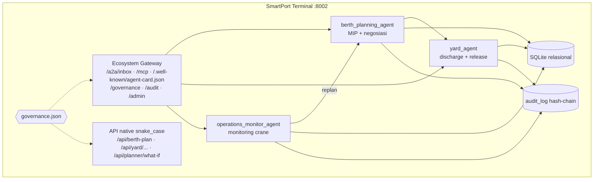

Setiap agen menjalankan siklus **perceive → reason → decide → act**: pesan/event dipersepsi, model AI/optimasi/aturan
dipakai untuk menalar, keputusan dicatat ke **audit lokal hash-chain** dan dilaporkan sebagai *decision trace*
(ringkas & boleh dibagikan) ke Control Center, lalu aksi berupa pesan A2A atau perubahan data lokal.

### 2.3 Dimensi heterogenitas

| Dimensi | OceanLine | SmartPort | GlobalCargo | ImportExport | Customs |
|---|---|---|---|---|---|
| Model data | dokumen JSON | relasional | relasional | relasional | relasional + hash-chain |
| Penamaan | camelCase | snake_case | PascalCase | bahasa Indonesia | snake_case + kode HS |
| Format API | JSON | JSON | envelope `{Status, Data}` | **XML** | JSON ketat |
| Waktu | UTC `Z` | lokal WIB | Unix epoch | `dd/mm/yyyy HH:MM` | ISO `+07:00` |
| Otorisasi | API key | API key | API key | API key | API key + **RBAC role** |
| Kebijakan keputusan | konsesi negosiasi, ambang ETA 0,5 j | objektif MIP, freeze 0,5 j, konsesi maks 40 jt | pool subkon, margin express | ambang harga, rasio manfaat/biaya express | **AI hanya rekomendasi** |

### 2.4 Komunikasi antar-agen (konsep A2A) dan akses tools (konsep MCP)
* **Agent Card** setiap server di `/.well-known/agent-card.json` (nama, URL inbox, skills, skema keamanan).
* **Pesan** (kontrak JSON simulasi, bukan implementasi lengkap A2A):

```json
{
  "message_id": "MSG-00051", "conversation_id": "CONV-BERTH-0830443-007", "in_reply_to": null,
  "sender": "smartport.berth_planning_agent", "receiver": "oceanline.negotiation_agent",
  "message_type": "PROPOSE", "task": "berth_negotiation", "sim_time_h": 1.0, "reply_required": true,
  "payload": {"neg_id": "NEG-E9DDB7", "round": 1, "max_rounds": 3, "offer": "A",
              "options": [{"option_id": "A", "vessels": [{"vessel_id": "V001", "berth_id": "B1",
                           "start_h": 13.5, "end_h": 20.0}]}, "..."]}
}
```

* Tipe pesan (performative ala FIPA-ACL): `INFORM, REQUEST, CFP, PROPOSE, COUNTER_PROPOSE, ACCEPT, REJECT, REFUSE,
  CONFIRM, ALERT, ENV_EVENT, MEDIATION_REQUEST`.
* **Message bus** di Control Center mengantar pesan **berurutan (FIFO, satu worker)** → urutan kausal deterministik,
  setiap pesan tercatat (status, latensi, respons) dan terlihat di dashboard.
* **Akses tools gaya MCP**: `POST /mcp` JSON-RPC 2.0 (`tools/list`, `tools/call`) dengan otorisasi per tool.
  Contoh: `customs.verification_agent` memanggil `oceanline.get_manifest` bila manifest belum diterima
  (GlobalCargo yang mencoba memanggil tool yang sama ditolak governance).

---

## 3. UI/UX tiap perusahaan (15%)

Setiap dashboard memiliki **login/role simulasi**, **modul bisnis**, **data explorer** (respons native + tabel),
**status agen** (state, beliefs, keputusan terakhir), **feed pesan A2A** miliknya, serta **audit & governance**.

| Dashboard | URL | Modul utama |
|---|---|---|
| 🌐 Control Center | :8500 | Ekosistem (J/C/T/R/Q, utilitas U_i), Skenario & injeksi event, Komunikasi agen (diagram sekuens + matriks aliran), Negosiasi, Decision trace, KPI & evaluasi, Data kanonik & schema mapping, Arsitektur & registry |
| 🚢 OceanLine | :8501 | Ringkasan armada, peta kapal, prediksi ETA (metrik, feature importance, what-if), negosiasi sandar, manifest |
| ⚓ SmartPort | :8502 | Gantt dermaga + garis "sekarang", riwayat & perbandingan versi rencana, optimizer MIP what-if, negosiasi, yard & ketersediaan kontainer |
| 🚚 GlobalCargo | :8503 | Status pengiriman, Gantt truk, graf jalan (ruas ditutup/macet), rute Dijkstra, armada/kontrak/job |
| 📦 ImportExport | :8504 | KPI dari XML, kesiapan dokumen (aturan R1–R7), analisis dokumen NLP, confusion matrix, kontrak & PIB, raw XML + hasil mapping |
| 🛃 Customs | :8505 | **Antrian petugas (Setujui/Tahan/Tolak)** dengan rekomendasi & penjelasan AI, deklarasi, model risiko + what-if, aturan kebijakan, audit hash-chain |

| | |
|---|---|
|  Control Center — status ekosistem | 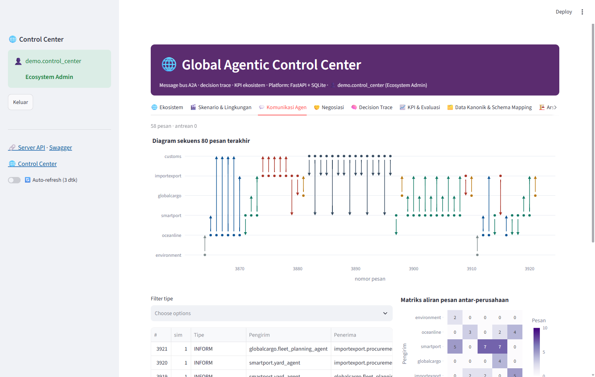 Diagram sekuens pesan A2A |
| 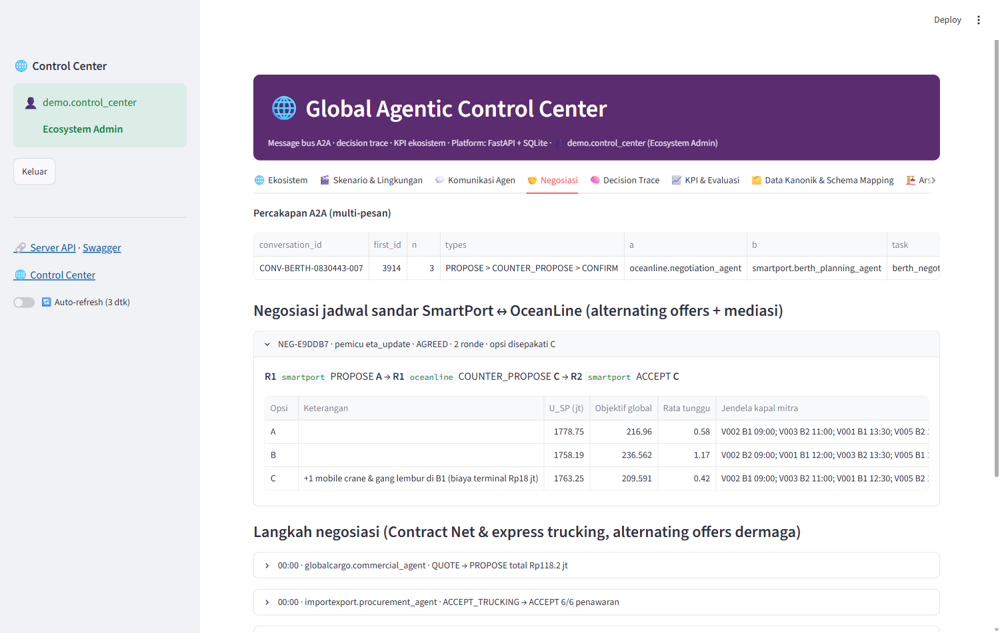 Negosiasi A → counter C → accept | 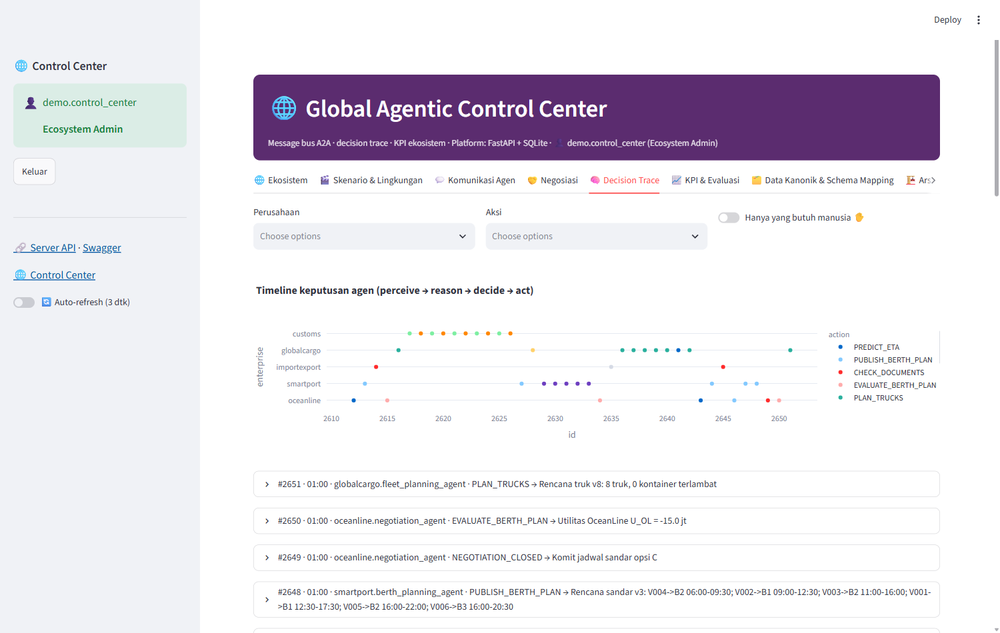 Decision trace |
| 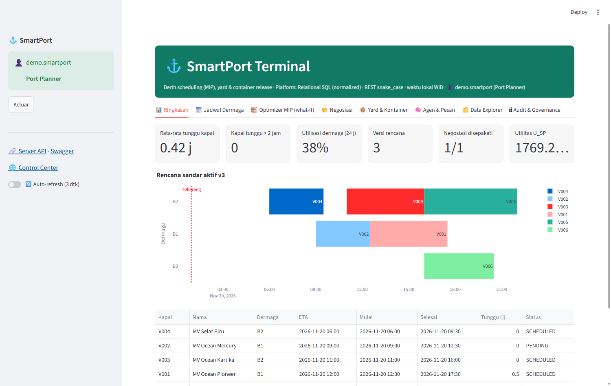 SmartPort — Gantt dermaga | 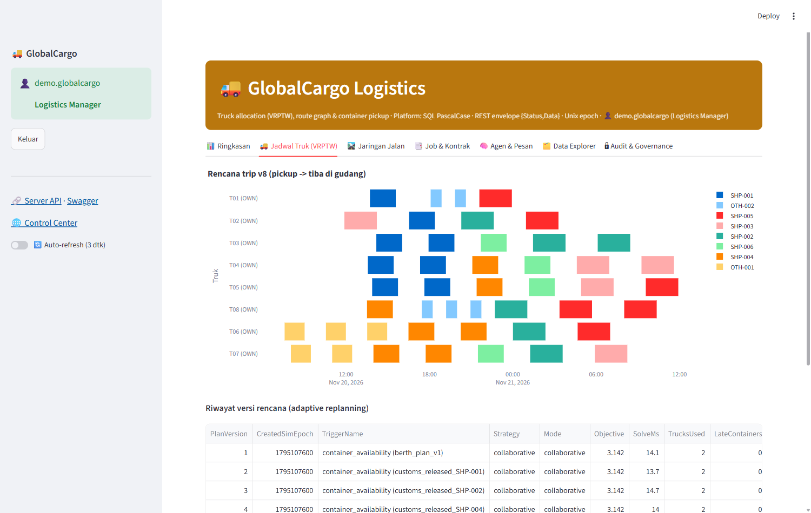 GlobalCargo — jadwal truk |
| 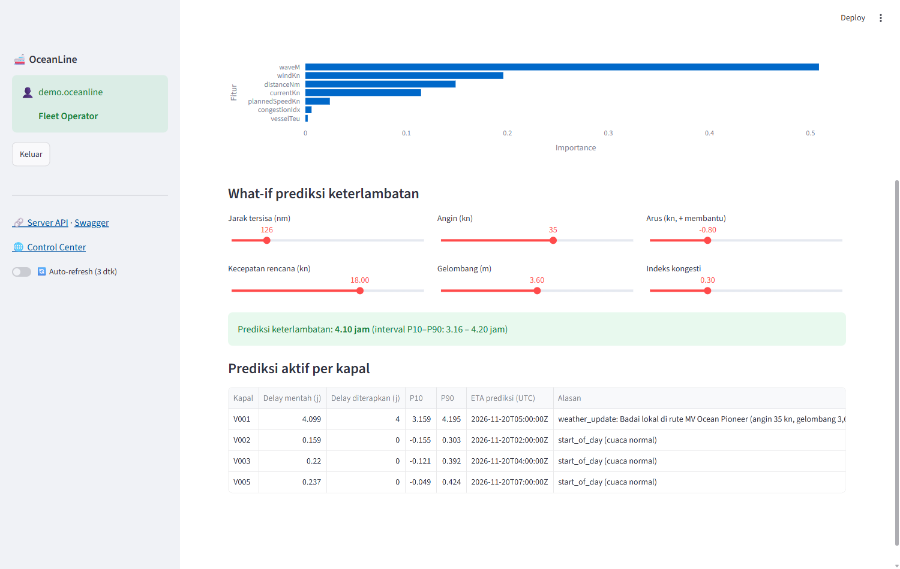 OceanLine — prediksi ETA | 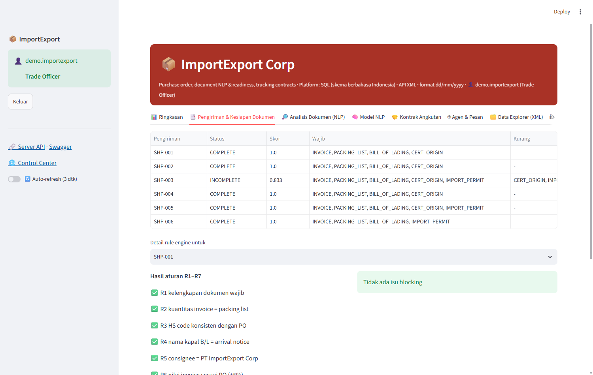 ImportExport — kesiapan dokumen |
| 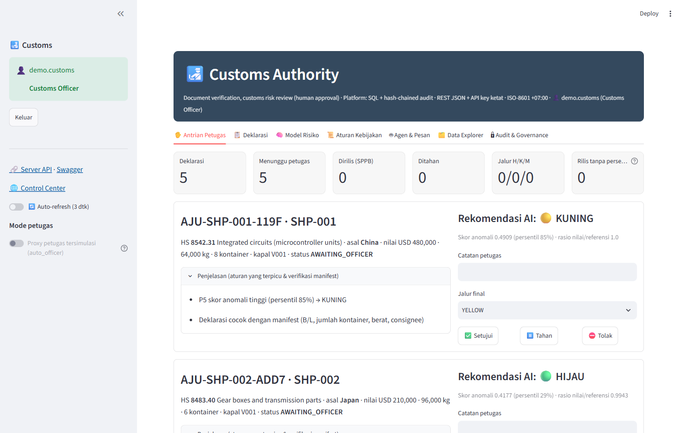 Customs — antrian petugas (HITL) | 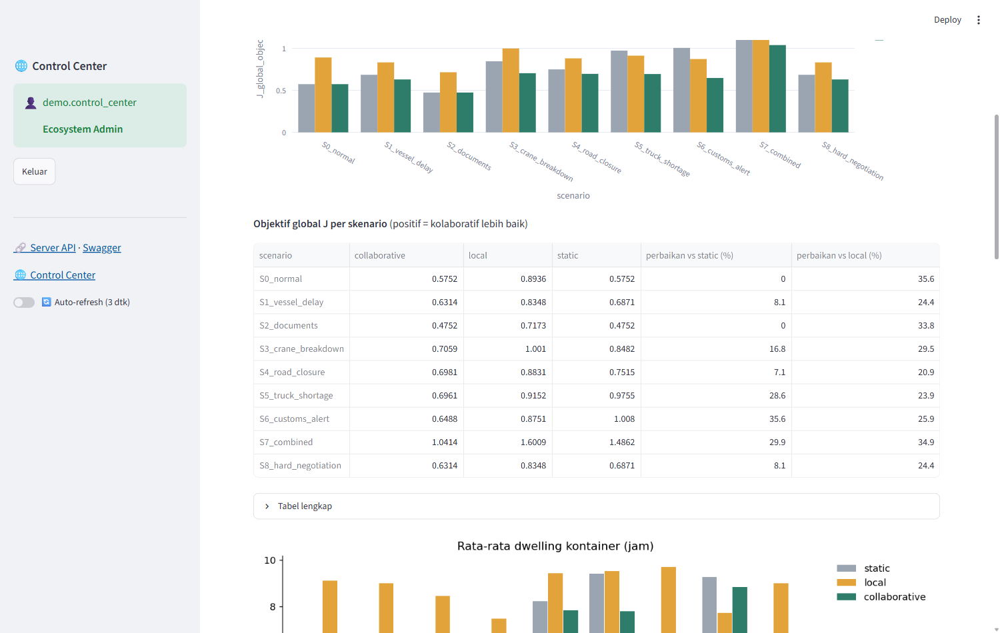 Evaluasi strategi |
| 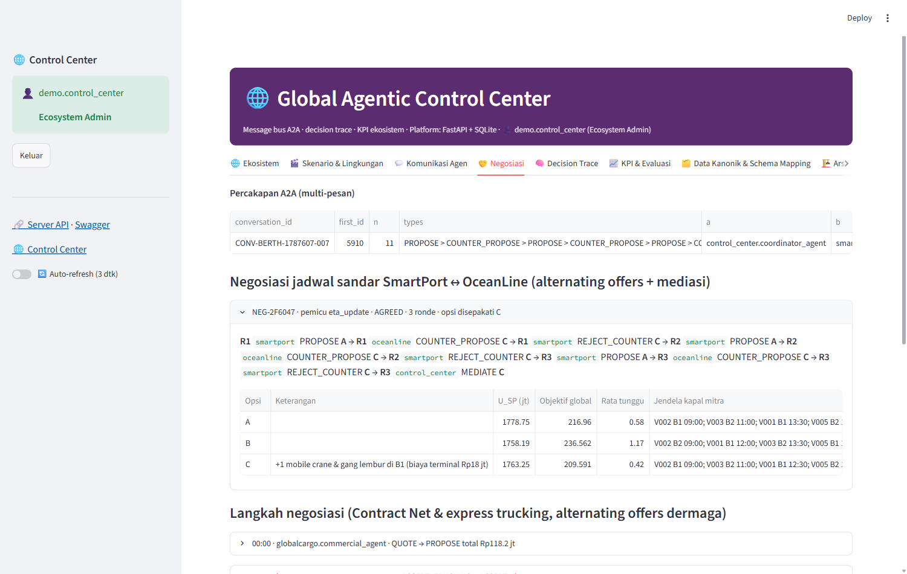 S8 — negosiasi buntu → mediasi | 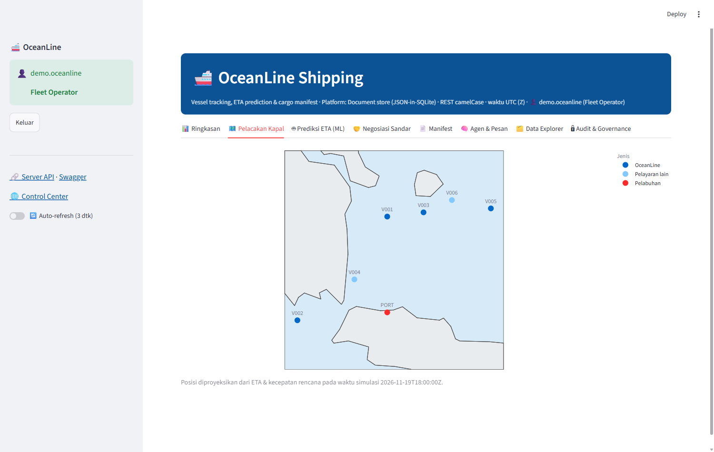 OceanLine — peta kapal |

Daftar lengkap screenshot ada di folder `docs/screenshots/`.

---

## 4. Model AI & algoritma (20%)

Ringkasan: **3 model prediktif/ML** (ETA regression, klasifikasi dokumen, anomaly detection), **3 algoritma
planning/optimization** (MIP berth allocation, VRPTW + local search, shortest path), **3 mekanisme negosiasi**
(alternating offers dengan konsesi waktu, Contract Net Protocol, mediasi Nash bargaining), plus **rule engine** dan
**monitoring** di setiap perusahaan.

### 4.1 OceanLine — prediksi keterlambatan ETA (model prediktif)
* **Model:** `GradientBoostingRegressor(n=800, depth=4, lr=0.03)` + regresi kuantil P10/P90 sebagai interval ketidakpastian.
* **Fitur:** jarak tersisa, kecepatan rencana, angin, gelombang, arus, indeks kongesti, ukuran kapal (TEU).
* **Data:** 6.000 voyage historis sintetis (fungsi fisik: kehilangan kecepatan akibat gelombang/angin + pembatasan pandu saat gelombang > 3 m).

| Metrik (uji 1.200 voyage) | Nilai |
|---|---|
| MAE Gradient Boosting | **0,246 jam** |
| R² | **0,977** |
| MAE baseline "ikuti jadwal" | 1,885 jam |
| MAE regresi linear | 1,381 jam |

Fitur terpenting: gelombang (0,51), angin (0,20), jarak (0,15), arus (0,11).
**Monitoring & reasoning:** perubahan ETA < 0,5 jam diabaikan (mencegah replanning berlebihan); delay dibulatkan ke slot 30 menit.
Skenario badai (126 nm, angin 35 kn, gelombang 3,6 m) → prediksi **4,10 jam** (P10–P90 3,2–4,2) → ETA V001 08:00 → **12:00**.

### 4.2 SmartPort — Berth Allocation Problem (Mixed-Integer Programming)
Formulasi *time-indexed* (slot 30 menit, horizon 48 jam), diselesaikan **SciPy `milp` (HiGHS)** dalam ±0,2 detik (≈960 variabel biner, 339 kendala):

$$\min \sum_{v,b,t} c_{vbt}\,x_{vbt}$$

$$\text{s.t.}\quad \sum_{b,t} x_{vbt}=1\ \ \forall v;\qquad \sum_{v}\sum_{t'\,:\,t'\le\tau<t'+p_{vbt'}} x_{vbt'} \le 1\ \ \forall b,\tau;\qquad x_{vbt}\in\{0,1\}$$

* $x_{vbt}=1$ jika kapal $v$ mulai sandar di dermaga $b$ slot $t$; hanya dibuat bila **LOA ≤ panjang** dan **draft ≤ kedalaman**, $t \ge$ ETA dan $t \ge$ sekarang; kapal yang sudah sandar **dibekukan**.
* $p_{vbt}$ = durasi sandar dari **integrasi profil produktivitas crane** (crane rusak → durasi bertambah).
* **Biaya global (ekosistem):** tunggu kapal (Rp12 jt/j, Rp6 jt/j bila diberi tahu ≥6 jam — *just-in-time arrival*), penalti telat berangkat (Rp10 jt/j), biaya crane (lembur malam ×1,5), biaya stabilitas rencana; kapal dengan dokumen *pending* berbobot 0,15.
* **Biaya lokal (SmartPort saja):** penalti kontrak (tunggu > 2 jam) + biaya crane — tanpa memikirkan biaya pelayaran.
* **Statis:** tidak ada re-optimasi; urutan & dermaga tetap, mulai = max(ETA baru, dermaga kosong) (FCFS).

### 4.3 GlobalCargo — routing & VRPTW
* **Graf jalan** 14 simpul/16 ruas (networkx), **Dijkstra** untuk waktu tempuh. Banjir menutup Bekasi–Cikarang → rute pindah ke arteri Kalimalang (84 → 156 menit ke Cikarang).
* **Multi-trip VRPTW full-truckload:** 1 kontainer = 1 job dengan *ready time* (bongkar + release Bea Cukai) dan *deadline* gudang; truk menjalankan Port→Gudang→Port.
* **Algoritma:** konstruksi greedy (EDD berbobot prioritas pada mode kolaboratif; FCFS pada mode lokal) + **local search relocate** (anggaran 2.500 evaluasi, deterministik); trip yang sudah berjalan dibekukan.
* **Objektif kolaboratif:** Σ bobot prioritas importir × keterlambatan shipment + SLA + lembur + kongesti yard (0,1 jt/kontainer-jam) + biaya truk. **Objektif lokal:** hanya biaya GlobalCargo.
* **What-if express:** sebelum menawar, agen mensimulasikan rencana dengan k truk subkon dan hanya menawar bila benar-benar mempercepat (mis. "subkon tidak mempercepat — bottleneck bongkar").

### 4.4 ImportExport — Document Intelligence
* **Klasifikasi jenis dokumen:** TF-IDF (word 1–2 gram + char 3–5 gram) + Logistic Regression, dilatih pada 720 dokumen sintetis termasuk fragmen pendek dan derau OCR → **akurasi uji 97,8%** (180 dokumen; kesalahan wajar antara B/L–Packing List).
* **Ekstraksi field:** regex (HS code, nilai, kuantitas, berat, B/L, kapal, negara asal, nomor izin, skema FTA).
* **Rule engine kesiapan R1–R7:** dokumen wajib (COO bila klaim FTA, izin impor bila lartas), kuantitas invoice = PL, HS konsisten dengan PO, kapal B/L = arrival notice, consignee, nilai ±5% PO, berat PL ≈ B/L (toleransi 2%, peringatan).
* Hasil: SHP-003 **INCOMPLETE** (kurang Persetujuan Impor & COO AIFTA); SHP-005 COMPLETE dengan peringatan berat 0,8%.

### 4.5 Customs — risk scoring (human-in-the-loop)
* **Isolation Forest** (n=300, contamination 0,08) pada fitur: log rasio nilai/referensi HS, risiko negara asal, skor importir, konsistensi dokumen, berat per kontainer, lartas tanpa izin.
* **Policy rules P1–P9** (MERAH: lartas tanpa izin, nota intelijen, nilai < 35% referensi, anomali ≥97% + risiko; KUNING: anomali ≥85%, nilai < 60%, konsistensi < 0,9, tidak cocok manifest, lartas berizin).
* Evaluasi pada 3.000 deklarasi historis: **ROC-AUC 0,927**, recall flag (K+M) **89,7%**, precision jalur merah **98,4%**.
* **AI hanya merekomendasikan jalur + penjelasan.** Release/hold/tolak hanya melalui `POST /customs/api/officer/decisions` dengan role *Customs Officer/Supervisor* (role lain → HTTP 403). Mode `auto_officer` adalah **proxy manusia tersimulasi** untuk evaluasi KPI dan dicatat `is_simulated_human=1`.

### 4.6 Negosiasi & reasoning lintas perusahaan
1. **Berth negotiation (SmartPort ↔ OceanLine) — alternating offers dengan konsesi berbasis waktu.**
   SmartPort membangkitkan opsi (optimum MIP, paksa dermaga alternatif, pertahankan dermaga lama, **+1 mobile crane & gang lembur** berbiaya Rp18 jt bagi terminal). Tiap pihak menilai opsi dengan **utilitas privat**; aspirasi turun linear:
   $a_i(k)=U_i^{max}-(U_i^{max}-U_i^{res})\cdot\frac{k-1}{K-1}$, $K=3$. Tawaran baru hanya opsi yang lebih baik bagi pihak penawar daripada *counter* lawan.
2. **Mediasi global (Control Center):** bila buntu sampai ronde K, mediator meminta utilitas secara privat dan memilih opsi **Nash bargaining** $\arg\max (U_{SP}-d_{SP})(U_{OL}-d_{OL})$, atau utilitarian bila tidak ada opsi di atas reservasi.
3. **Contract Net Protocol (ImportExport ↔ GlobalCargo):** CFP trucking standar → PROPOSE harga → ACCEPT; **CFP express** bila rencana pengiriman melewati batas waktu PO — ImportExport menerima bila denda yang dihindari ≥ 1,2 × surcharge.

**Contoh nyata (S1):** SmartPort `PROPOSE A` (U_SP=1778,75) → OceanLine `COUNTER_PROPOSE C` (U_OL: A=−37,7; C=−15,0) →
SmartPort menolak di ronde 1 (aspirasi = 1778,75) tetapi **berkonsesi di ronde 2** (aspirasi turun 20 jt; U_SP(C)=1763,25)
→ `ACCEPT C` → `CONFIRM`. Opsi C juga memiliki **objektif global terbaik** (209,6 vs 217,0) — kesepakatan lokal selaras
dengan kecerdasan ekosistem.

### 4.7 Model matematika global
$$\min_{x\in\mathcal F} J = \alpha\frac{C}{C_{ref}} + \beta\frac{T}{T_{ref}} + \gamma\frac{R}{R_{ref}} - \delta Q,\qquad (\alpha,\beta,\gamma,\delta)=(0{,}4;\ 0{,}3;\ 0{,}2;\ 0{,}1)$$

* **C** = biaya tunggu & telat kapal + biaya crane/gang + biaya armada truk + denda produksi importir + kongesti yard (juta Rp); $C_{ref}=300$.
* **T** = rata-rata tunggu kapal + rata-rata dwelling kontainer (jam); $T_{ref}=9$.
* **R** = kontainer menunggu release/4 + deklarasi menunggu petugas + ditahan + dokumen pending + 10 × pelanggaran kepatuhan; $R_{ref}=2$.
* **Q** = rasio kontainer terkirim tepat waktu.
* Otonomi tetap dijaga: $U_i=\text{Revenue}_i-\text{Cost}_i-\text{RiskPenalty}_i$ dihitung & ditampilkan per perusahaan; kesepakatan negosiasi harus berada di atas reservasi masing-masing.

---

## 5. Dataset input–output & schema mapping (10%)

### 5.1 Data sintetis (`python -m data.generate_synthetic`, seed 42)

| Perusahaan | File (format native) | Isi |
|---|---|---|
| OceanLine | `fleet.json`, `manifests.json`, `voyage_history.csv` (6.000) | 6 kapal (4 milik OceanLine), 8 B/L, histori voyage untuk ML |
| SmartPort | `berths.csv`, `vessel_calls.csv`, `container_batches.csv`, `yard_blocks.csv` | 3 dermaga, 6 kunjungan kapal, batch kontainer per shipment |
| GlobalCargo | `road_nodes.csv`, `road_edges.csv`, `trucks.csv` (8), `contracts.csv` | graf jalan, armada, kontrak pelanggan lain |
| ImportExport | `purchase_orders.csv`, `shipments.csv`, `documents/*.txt` (25), `documents_pending/*.txt`, `doc_training.csv` (720) | 6 PO/shipment, dokumen perdagangan teks |
| Customs | `hs_reference.csv` (16), `origin_risk.csv`, `declaration_history.csv` (3.000) | nilai referensi HS, risiko negara asal, histori berlabel |

### 5.2 Input skenario (sesuai studi kasus + perluasan)

| Kapal | Pelayaran | Kontainer | ETA | Dermaga pilihan | Status dokumen |
|---|---|---|---|---|---|
| V001 MV Ocean Pioneer | OceanLine | 400 | 08:00 | B1 | Complete |
| V002 MV Ocean Mercury | OceanLine | 250 | 09:00 | B1 | **Incomplete** (SHP-003) |
| V003 MV Ocean Kartika | OceanLine | 300 | 11:00 | B2 | Complete |
| V004 MV Selat Biru | PT Pelayaran Mitra | 180 | 06:00 | B3 | Complete |
| V005 MV Ocean Rinjani | OceanLine | 350 | 14:00 | B2 | Complete |
| V006 MV Bahari Lestari | Samudera Kargo | 150 | 16:00 | B3 | Complete |

Dermaga: B1 (350 m, draft 14,5 m, 3 crane), B2 (300 m, 13,0 m, 3 crane), B3 (220 m, 11,0 m, 2 crane) — V001 hanya muat di B1.

### 5.3 Output agen

**Kondisi normal (rencana v2, MIP global):**

| Kapal | Rekomendasi agen | Status |
|---|---|---|
| V001 | Dermaga B1, 08:00–14:30 | Scheduled |
| V002 | Slot tentatif B2 09:00–13:30 + review dokumen SHP-003 | **Pending** |
| V003 | Dermaga B2, 13:30–18:30 (tunggu 2,5 j; lebih murah daripada V002 menunggu 7 j dan telat berangkat) | Scheduled |
| V004 / V005 / V006 | B3 06:00 / B1 14:30 / B3 16:00 | Scheduled |

**Setelah V001 terlambat 4 jam (strategi kolaboratif, hasil negosiasi opsi C, rencana v3):**

| Kapal | Rekomendasi agen | Perubahan |
|---|---|---|
| V002 | B1 09:00–12:30 (masuk lebih awal ke slot kosong V001) | B2 → B1 |
| V003 | B2 11:00–16:00, **tunggu 0 j** | 13:30 → 11:00 |
| V001 | B1 12:30–17:30 dengan +1 mobile crane, tunggu 0,5 j, tanpa telat berangkat | 08:00 → 12:30 |
| V004 / V005 | B2 06:00 / B2 16:00 | dermaga disesuaikan |

**Rekomendasi Bea Cukai (AI) → keputusan petugas:**

| Shipment | HS / asal | Rekomendasi AI | Alasan utama |
|---|---|---|---|
| SHP-001 | 8542.31 China | 🟡 KUNING | anomali persentil 85% |
| SHP-002 | 8483.40 Japan | 🟢 HIJAU | tidak ada aturan terpicu |
| SHP-004 | 5208.52 Vietnam | 🟢 HIJAU | tidak ada aturan terpicu |
| SHP-005 | 7208.51 Korea | 🟡 KUNING | anomali 92%, konsistensi dokumen 0,85, komoditas lartas |
| SHP-006 | 8517.13 China | 🔴 MERAH | nilai 29% dari referensi (undervaluation), anomali 97% |
| SHP-003 | 2915.12 India | (menunggu dokumen) | deklarasi baru diajukan setelah dokumen lengkap (S2) |

Output lain: rencana trip truk per kontainer (Gantt), status pengiriman per shipment, kontrak & surcharge express,
decision trace, audit log hash-chain, dan KPI ekosistem.

### 5.4 Schema mapping
Adapter di `common/schema_mapping.py` memetakan format native → **model kanonik** (waktu = jam sejak T0, snake_case, juta Rp):

| Native | Contoh | Kanonik |
|---|---|---|
| OceanLine `predictedEtaUtc` | `2026-11-20T05:00:00Z` | `eta_h = 12.0` |
| SmartPort `start_time` | `2026-11-20 12:30` | `start_h = 12.5` |
| GlobalCargo `LastDeliveryEpoch` (dalam `Data`) | `1795...` | `last_delivery_h` |
| ImportExport `<status_pabean>RILIS</status_pabean>` | XML | `customs_status = RELEASED` |
| Customs `release_at` | `2026-11-20T03:00:00+07:00` | `release_h = 3.0` |

---

## 6. Adaptive agentic simulation & evaluasi KPI (15%)

### 6.1 Alur normal & adaptasi (S1)

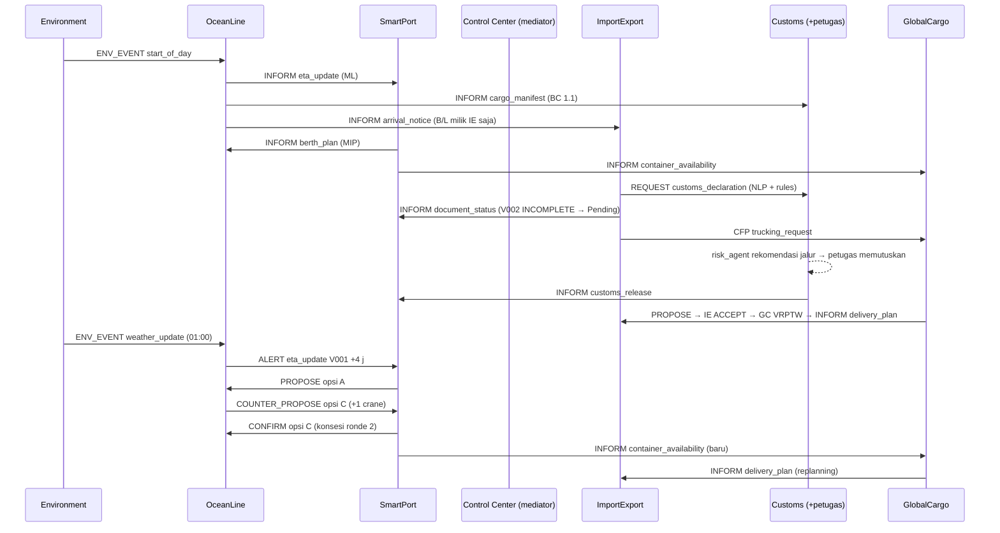

Jika negosiasi buntu, SmartPort mengirim `MEDIATION_REQUEST` ke `control_center.coordinator_agent`, yang meminta utilitas
OceanLine secara privat lalu memutuskan via Nash bargaining. Jika rencana pengiriman melewati batas waktu PO dan
kontainer sudah dirilis, ImportExport mengirim `CFP express_request` (terlihat di S7: 2 kontrak express, 4 trip truk subkon).

### 6.2 Skenario

| ID | Gangguan (waktu simulasi) | Agen yang mempersepsi |
|---|---|---|
| S0 | kondisi normal | — |
| S1 | badai: V001 terlambat ±4 jam (01:00) | `oceanline.eta_agent` |
| S2 | dokumen susulan SHP-003 tiba (07:00) | `importexport.document_agent` |
| S3 | 2 dari 3 crane B1 rusak, produktivitas 34% (10:00–22:00) | `smartport.operations_monitor_agent` |
| S4 | banjir menutup tol Bekasi–Cikarang, arteri ×1,6 (12:00) | `globalcargo.route_agent` |
| S5 | 4 dari 8 truk ditarik (09:00–19:00) | `globalcargo.fleet_planning_agent` |
| S6 | nota intelijen HS 8542 asal China (10:00) → HOLD & pemeriksaan ulang | `customs.risk_agent` |
| S7 | gabungan S1 + S2 + S3 + S4 | beberapa agen |
| S8 | S1 dengan kebijakan negosiasi ketat (konsesi SmartPort ≤ 5 jt, toleransi OceanLine 20 jt) → buntu → **mediasi** | `smartport` ↔ `oceanline` ↔ `control_center.coordinator_agent` |

### 6.3 Strategi pembanding (local vs global intelligence)

| Strategi | Deskripsi |
|---|---|
| **static** | rencana awal dibekukan setelah baseline; gangguan ditangani FCFS (baseline non-agentic) |
| **local** | *local enterprise intelligence*: tiap perusahaan re-optimasi untuk dirinya sendiri, tanpa negosiasi & tanpa berbagi prioritas |
| **collaborative** | *global ecosystem intelligence*: objektif ekosistem, negosiasi A2A, mediasi, berbagi bobot prioritas, CFP express |

### 6.4 Hasil (`python -m simulation.run_evaluation`, simulasi multi-agen sungguhan via HTTP)

**Objektif global J (lebih kecil lebih baik):**

| Skenario | static | local | **collaborative** | perbaikan vs static | perbaikan vs local |
|---|---|---|---|---|---|
| S0 normal | 0,575 | 0,894 | **0,575** | 0% | 35,6% |
| S1 kapal terlambat | 0,687 | 0,835 | **0,631** | 8,1% | 24,4% |
| S2 dokumen | 0,475 | 0,717 | **0,475** | 0% | 33,8% |
| S3 crane rusak | 0,848 | 1,001 | **0,706** | 16,8% | 29,5% |
| S4 banjir | 0,752 | 0,883 | **0,698** | 7,1% | 20,9% |
| S5 truk berkurang | 0,976 | 0,915 | **0,696** | 28,6% | 23,9% |
| S6 intelijen BC | 1,008 | 0,875 | **0,649** | 35,6% | 25,9% |
| S7 gabungan | 1,486 | 1,601 | **1,041** | 29,9% | 34,9% |
| S8 negosiasi alot (mediasi) | 0,687 | 0,835 | **0,631** | 8,1% | 24,4% |

Rata-rata pada skenario gangguan (S1, S3–S7): kolaboratif **21% lebih baik dari static**; pada semua 9 skenario
**28,1% lebih baik dari local**. Pada S8 negosiasi buntu 3 ronde lalu dimediasi Control Center dan tetap menghasilkan
opsi C (objektif global terbaik) — mekanisme mediasi menjaga kualitas keputusan ekosistem walau agen lokal keras kepala.

**Detail KPI terpilih:**

| Skenario · strategi | Biaya C (jt) | Tunggu kapal (j) | Dwelling (j) | Tepat waktu | Denda importir (jt) | Telat berangkat |
|---|---|---|---|---|---|---|
| S1 · static | 346,6 | 1,17 | 5,58 | 100% | 0 | 2 |
| S1 · local | 378,2 | 0,58 | 9,01 | 89,1% | 44,2 | 1 |
| **S1 · collaborative** | **314,6** | **0,42** | 5,94 | **100%** | **0** | **0** |
| S5 · static | 470,6 | 0,50 | 9,42 | 82,6% | 149,2 | 0 |
| **S5 · collaborative** | **314,8** | 0,50 | **7,79** | **100%** | **0** | 0 |
| S6 · static | 587,8 | 0,50 | 5,90 | 89,1% | 281,5 | 0 |
| **S6 · collaborative** | **308,9** | 0,50 | 6,61 | **100%** | **0** | 0 |
| S7 · static | 875,6 | 2,25 | 9,27 | 65,2% | 275,1 | 2 |
| S7 · local | 1.024,0 | 1,50 | 7,72 | 71,7% | 504,3 | 2 |
| **S7 · collaborative** | **583,4** | **1,08** | 8,85 | 67,4% | **85,4** | 2 |

**Interpretasi**
* **Keputusan berubah secara terukur** saat lingkungan berubah: versi rencana dermaga/truk bertambah, kapal pindah dermaga, kontrak express dibuat — lihat tab *KPI & Evaluasi* dan *Decision Trace*.
* **Local intelligence tidak cukup:** bahkan pada kondisi normal, objektif egois SmartPort (menghindari lembur) dan GlobalCargo (tanpa bobot prioritas importir) menaikkan denda importir (Rp75,7 jt di S0).
* **Static rapuh terhadap gangguan hilir:** pada S6 (hold Bea Cukai) urutan truk yang beku menyebabkan denda Rp281,5 jt; kolaboratif menjadwal ulang sehingga denda 0.
* **Trade-off jujur:** dwelling kolaboratif kadang sedikit lebih tinggi daripada static (S1: 5,94 vs 5,58 j) karena VRP memprioritaskan batas waktu produksi; pada S7 rasio tepat-waktu local lebih tinggi tetapi denda tertimbangnya 6× lebih besar.
* **Kepatuhan:** `released_without_human_approval = 0` di seluruh 27 run.

---

## 7. Testing & dokumentasi (10%)

### 7.1 Pengujian otomatis (`python -m pytest tests -v` → **16 passed**)

| Test | Yang diverifikasi |
|---|---|
| `test_time_formats_roundtrip` | 5 format waktu native ↔ kanonik |
| `test_mip_feasible_no_overlap_and_compatible` | MIP optimal, tanpa tumpang tindih, kompatibilitas fisik, t ≥ ETA |
| `test_adaptive_beats_static_after_delay` | re-optimasi mengurangi waktu tunggu vs FCFS |
| `test_crane_degradation_extends_processing` | integrasi produktivitas crane |
| `test_dijkstra_reroutes_when_road_closed` | rute berubah saat ruas ditutup |
| `test_vrp_respects_ready_times_and_one_job_per_truck_at_a_time` | kelayakan VRPTW |
| `test_eta_model_beats_schedule_baseline` | MAE < 50% baseline, R² > 0,9, skenario badai ±4 jam |
| `test_document_classifier_and_rules` | akurasi > 90%, ekstraksi, rule engine kelengkapan |
| `test_customs_risk_flags_undervaluation` | AUC > 0,8, undervaluation & tanpa izin → MERAH |
| `test_importexport_xml_mapping`, `test_globalcargo_envelope_mapping` | schema mapping |
| `test_all_servers_healthy_and_publish_agent_cards` | 5 server + Agent Card |
| `test_governance_blocks_unauthorized_access` | 403/401, tool MCP ditolak untuk pihak tak berwenang |
| `test_vessel_delay_triggers_negotiation_and_measurable_change` | negosiasi terjadi, keputusan berubah, J kolaboratif < static, semua pesan terkirim |
| `test_deadlocked_negotiation_is_mediated_by_control_center` | negosiasi buntu (S8) dimediasi koordinator global |
| `test_customs_requires_human_decision` | deklarasi menunggu petugas; role non-petugas ditolak; petugas dapat merilis |

Selain itu dilakukan uji manual seluruh 6 dashboard (semua tab dirender tanpa error) dan uji alur HITL: petugas
menyetujui deklarasi dari dashboard Customs → pesan `customs_release` → `yard_agent` → `fleet_planning_agent`
melakukan replanning → `delivery_plan` ke ImportExport.

### 7.2 Petunjuk VS Code
Lihat `README.md` §1: install dependensi, generate data, `python run_all.py --open`, atau `F5` → *Ekosistem lengkap*,
atau *Terminal → Run Task*. Konfigurasi tersedia di `.vscode/launch.json`, `tasks.json`, `settings.json`.

### 7.3 Skrip demo presentasi (±10 menit)
1. Buka 6 browser/tab (8500–8505) → tunjukkan bahwa tiap perusahaan punya UI, server, dan format data sendiri (tab *Data Explorer*, terutama XML ImportExport).
2. Control Center → S1 Collaborative, jeda 0,4 dtk → amati diagram sekuens secara live.
3. Tab Negosiasi → jelaskan A → counter C → konsesi; tab Decision Trace → penalaran MIP & utilitas.
4. Dashboard SmartPort → bandingkan versi rencana v2 vs v3; GlobalCargo → replanning truk.
5. Jalankan S1 Static → bandingkan KPI (perubahan keputusan terukur).
6. Matikan proxy petugas → jalankan S0 → Customs: putuskan deklarasi MERAH (SHP-006) dengan penjelasan AI.
7. Tutup dengan tab KPI & Evaluasi (9 skenario × 3 strategi).

---

## 8. Keterbatasan, etika, dan pengembangan

* **Data sintetis** → angka KPI menggambarkan perilaku sistem, bukan kinerja pelabuhan nyata; model ML dilatih pada fungsi pembangkit yang diketahui.
* **Simulasi berbasis rencana:** KPI dihitung dari rencana terbaru (bukan eksekusi fisik detik demi detik); trip/sandar yang sudah dimulai dibekukan.
* **Kontrak pesan A2A/MCP** bersifat simulasi (subset konsep: Agent Card, pesan bertipe, JSON-RPC tools), bukan implementasi spesifikasi penuh.
* **Keamanan:** API key statis untuk demo; produksi memerlukan OAuth2/mTLS dan manajemen rahasia.
* **Governance (NIST AI RMF):** fungsi *Govern* (governance.json, RBAC), *Map* (konteks & batasan AI per perusahaan), *Measure* (metrik model & KPI), *Manage* (human-in-the-loop, audit hash-chain, ambang & freeze untuk mencegah osilasi).
* **Pengembangan:** LLM untuk penjelasan keputusan & ekstraksi dokumen tidak terstruktur, reinforcement learning untuk strategi konsesi, MIP terintegrasi berth–yard–truck, data AIS nyata, standar DCSA/EPCIS untuk event kontainer.

---

## 9. Referensi
1. Wooldridge, M. (2009). *An Introduction to MultiAgent Systems*. Wiley. (negosiasi, Contract Net, konsesi)
2. Russell, S. & Norvig, P. (2021). *Artificial Intelligence: A Modern Approach*. Pearson. (agen rasional, constraint/planning)
3. Jennings, N.R., Sycara, K. & Wooldridge, M. (1998). A Roadmap of Agent Research and Development. *AAMAS*, 1, 7–38.
4. Sutton, R.S. & Barto, A.G. (2018). *Reinforcement Learning: An Introduction*. MIT Press.
5. NIST (2023). *AI Risk Management Framework (AI RMF 1.0)*.
6. Agent2Agent Protocol — Official Specification. a2a-protocol.org.
7. Model Context Protocol — Official Documentation. modelcontextprotocol.io.
8. Bierwirth, C. & Meisel, F. (2015). A follow-up survey of berth allocation and quay crane scheduling problems in container terminals. *EJOR*, 244(3), 675–689.
9. Toth, P. & Vigo, D. (2014). *Vehicle Routing: Problems, Methods, and Applications* (2nd ed.). SIAM.
10. Liu, F.T., Ting, K.M. & Zhou, Z.-H. (2008). Isolation Forest. *ICDM*.
11. Friedman, J.H. (2001). Greedy function approximation: a gradient boosting machine. *Annals of Statistics*.
12. Nash, J. (1950). The Bargaining Problem. *Econometrica*, 18(2), 155–162.
13. IATA ONE Record; GS1 EPCIS; International Maritime Organization — konteks interoperabilitas data kargo & operasi maritim.
